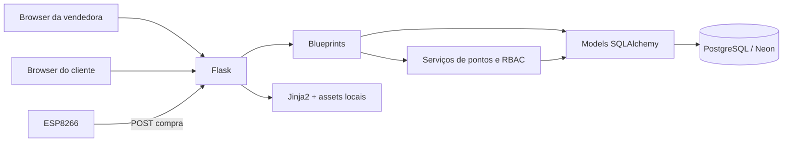
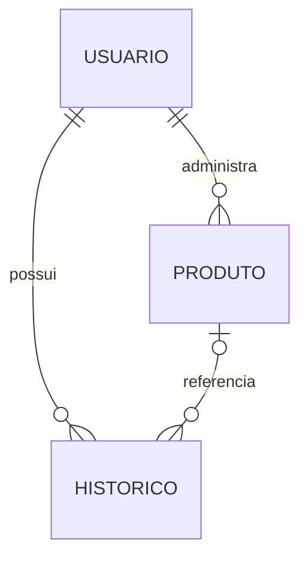

# Arquitetura validada

A aplicação é um monólito Flask com Application Factory. As rotas consultam os models diretamente; não existe uma repository layer completa.

## Modelo

`usuario` contém os perfis ADMIN e CLIENTE. `historico.tipo_movimentacao` discrimina COMPRA, RESGATE, AJUSTE_POSITIVO, AJUSTE_NEGATIVO, ESTORNO e EXPIRACAO.

## Decisões

- Uma compra equivale a um ponto.
- Não há valor monetário em compras.
- Não há gestão de equipes.
- Não há auditoria operacional.
- O histórico transacional é preservado.
- PostgreSQL é o banco operacional; SQLite fica restrito a testes unitários.
