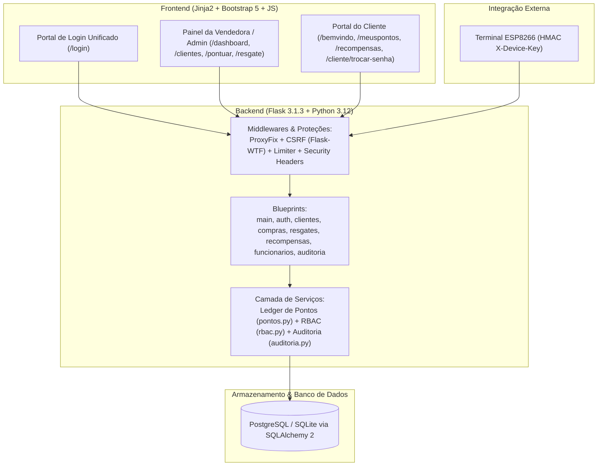

# 01 — Mapeamento da Aplicação e Arquitetura

## 1. Visão Geral da Arquitetura

O sistema **IT Clube (FideliZa)** é uma plataforma web para gestão de programas de fidelização de clientes, compras no ponto de venda (PDV), resgate de prêmios e pontuação integrada via terminal IoT (ESP8266).

### Tecnologias e Componentes
- **Backend**: Python 3.12, Flask 3.1.3, Werkzeug 3.1.3.
- **ORM & Banco de Dados**: Flask-SQLAlchemy 3.1.1, SQLAlchemy 2.0.46, Flask-Migrate 4.1.0, psycopg2-binary.
  - Suporte a **PostgreSQL (Neon Cloud)** com SSL e pool otimizado;
  - Suporte a **SQLite local** para testes e desenvolvimento offline.
- **Autenticação & Sessão**: Flask-Login 0.6.3, hashes com PBKDF2-HMAC-SHA256 (Werkzeug), cookies de sessão com atributos `HttpOnly`, `SameSite=Lax`, e `Secure` em produção.
- **Proteção de Formulários e APIs**: Flask-WTF 1.3.0 (tokens CSRF sincronizados), Flask-Limiter 4.1.1 (prevenção contra força bruta e DoS).
- **Frontend**: Jinja2 templates, Bootstrap 5.3, Bootstrap Icons, FontAwesome 6.5, CSS customizado e JavaScript nativo (Fetch API).
- **Dispositivo Externo**: Terminal PDV IoT com autenticação por chave criptográfica pré-compartilhada via header `X-Device-Key` e verificação com `hmac.compare_digest`.

---

## 2. Matriz Completa de Rotas e Endpoints

| Método | Endpoint | Autenticação | Perfil / Permissão | Entrada | Ação Principal |
| :--- | :--- | :--- | :--- | :--- | :--- |
| `GET` | `/` | Não | Público | Nenhuma | Redireciona usuários autenticados ou exibe portal de login. |
| `GET` | `/health` | Não | Público | Nenhuma | Endpoint de liveness probe e monitoramento de integridade. |
| `GET` | `/setup` | Não | Primeiro acesso | Nenhuma | Renderiza formulário de provisionamento seguro da administradora. |
| `POST` | `/setup` | Não | Primeiro acesso | `nome`, `login`, `email`, `senha`, `confirmar_senha` | Cria a conta proprietária inicial da loja caso o sistema esteja vazio. |
| `GET` | `/cadastro` | Não | Público | Nenhuma | Redireciona para o cadastro público de clientes finais. |
| `GET` | `/dashboard` | Sim | Vendedora | Nenhuma | Renderiza painel administrativo principal. |
| `GET` | `/api/dashboard/estatisticas`| Sim | Vendedora | Nenhuma | Retorna agregados em tempo real (faturamento, clientes, saldo). |
| `GET` | `/clientes` | Sim | Vendedora | Nenhuma | Renderiza tela de gestão de clientes. |
| `GET` | `/funcionarios`| Sim | `funcionarios.visualizar` | Nenhuma | Renderiza interface de equipe e controle de colaboradores. |
| `GET` | `/pontuar` | Sim | Vendedora | Nenhuma | Renderiza formulário de pontuação manual no balcão. |
| `GET` | `/resgate` | Sim | Vendedora | Nenhuma | Renderiza interface de baixa física de prêmios. |
| `GET` | `/gestao-recompensas` | Sim | Vendedora | Nenhuma | Renderiza catálogo administrativo de recompensas. |
| `GET` | `/relatorios` | Sim | Vendedora | Nenhuma | Renderiza painel de relatórios analíticos de vendas e resgates. |
| `GET` | `/alterar-senha` | Sim | Vendedora | Nenhuma | Renderiza tela de redefinição de senha da vendedora. |
| `GET` | `/bemvindo` | Sim | Cliente | Nenhuma | Área inicial do cliente pós-login com resumo de pontos. |
| `GET` | `/meuspontos` | Sim | Cliente | Nenhuma | Exibe extrato detalhado de pontuação pessoal. |
| `GET` | `/recompensas`| Sim | Cliente | Nenhuma | Catálogo de recompensas disponíveis para troca. |
| `GET` | `/historico` | Sim | Cliente | Nenhuma | Histórico pessoal de compras e pontuações. |
| `GET` | `/perfil` | Sim | Cliente | Nenhuma | Edição cadastral e troca de senha voluntária. |
| `GET` | `/cliente/trocar-senha` | Sim | Cliente | Nenhuma | Tela obrigatória de redefinição no 1º acesso (cadastrado por vendedora). |
| `GET` | `/trocar-senha` | Sim | Autenticado | Nenhuma | Roteador inteligente que direciona cliente ou vendedora à respectiva troca. |
| `POST`| `/auth/login` | Não | Público (Vendedora) | `email`/`login`, `senha` | Autentica vendedora/admin; rejeita explicitamente perfil cliente. |
| `POST`| `/auth/cliente/login` | Não | Público (Cliente) | `telefone`/`email`, `senha` | Autentica cliente final; rejeita explicitamente perfil vendedora. |
| `GET/POST`| `/auth/logout` | Sim | Autenticado | Nenhuma | Invalida a sessão, limpa cookies e registra auditoria. |
| `GET` | `/auth/me` | Sim | Autenticado | Nenhuma | Retorna dados do usuário atualmente logado. |
| `GET` | `/auth/cadastro` | Não | Público | Nenhuma | Renderiza página web de auto-cadastro de clientes. |
| `POST`| `/auth/cadastro` | Não | Público | Form Flask-WTF (`nome`, `telefone`, `email`, `senha`) | Realiza autocadastro com validação CSRF e complexidade de senha. |
| `POST`| `/auth/alterar-senha` | Sim | Vendedora | `senha_atual`, `nova_senha`, `confirmar_nova_senha` | Altera senha administrativa com verificação de complexidade e histórico. |
| `GET` | `/api/clientes/me` | Sim | Cliente | Nenhuma | Retorna perfil próprio do cliente logado (prevenção BOLA/IDOR). |
| `PUT` | `/api/clientes/me` | Sim | Cliente | `nome`, `telefone`, `email`, `endereco` | Atualiza dados cadastrais do próprio cliente (bloqueia alteração de saldo). |
| `POST`| `/api/clientes/me/alterar-senha`| Sim | Cliente | `senha_atual`, `nova_senha`, `confirmar_nova_senha` | Altera a senha do cliente e desmarca flag `precisa_trocar_senha`. |
| `GET` | `/api/clientes/` | Sim | `clientes.visualizar` | Query params: `q`, `status`, `sort_by`, `order`, `page`, `per_page` | Lista clientes com busca textual, ordenação e paginação. |
| `POST`| `/api/clientes/` | Sim | `clientes.criar` | `nome`, `telefone`, `email`, `endereco`, `senha` | Cadastra cliente no PDV com senha inicial (`precisa_trocar_senha=True`). |
| `GET` | `/api/clientes/<id>` | Sim | `clientes.visualizar` ou Próprio Cliente | Path param: `id` | Obtém detalhes do cliente e histórico consolidado. |
| `PUT` | `/api/clientes/<id>` | Sim | `clientes.editar` | `nome`, `telefone`, `email`, `endereco` | Atualiza cadastro de cliente pela vendedora. |
| `POST`| `/api/clientes/<id>/status` | Sim | `clientes.desativar` | `ativo`, `motivo` | Ativa ou desativa conta de cliente (soft disable). |
| `POST`| `/api/clientes/<id>/pontos/ajuste` | Sim | `pontos.adicionar` ou `pontos.remover` | `operacao`, `quantidade`, `motivo` | Realiza crédito ou débito manual no ledger de pontos. |
| `GET` | `/api/clientes/<id>/extrato` | Sim | `pontos.visualizar` ou Próprio Cliente | Path param: `id` | Retorna o extrato imutável de movimentações de pontos. |
| `GET` | `/api/compras/` | Sim | `pontos.visualizar` ou Cliente | Query param: `id_cliente` (opcional) | Lista compras/pontuações segregadas por perfil. |
| `POST`| `/api/compras/` | Sim*| Vendedora (`pontos.adicionar`) ou IoT | `id_cliente` ou `telefone`, `valor` | Registra compra (+1 ponto) via sessão web ou dispositivo IoT. |
| `GET` | `/api/resgates/` | Sim | Vendedora ou Cliente | Query param: `id_cliente` (opcional) | Lista resgates realizados (cliente vê apenas os seus). |
| `POST`| `/api/resgates/` | Sim | `resgates.validar` | `id_cliente` ou `telefone`, `id_recompensa` | Validação atômica e baixa física de prêmio no PDV. |
| `GET` | `/api/recompensas/` | Sim | Autenticado | Nenhuma | Lista catálogo de recompensas (cliente vê apenas válidas). |
| `POST`| `/api/recompensas/` | Sim | `recompensas.criar` | `nome`, `custo_pontos`, `tipo`, `validade`, `quantidade_total`, etc. | Cria nova recompensa no catálogo da loja. |
| `GET` | `/api/recompensas/<id>` | Sim | Autenticado | Path param: `id_recompensa` | Consulta recompensa específica. |
| `PATCH`| `/api/recompensas/<id>`| Sim | `recompensas.editar` | Atributos permitidos | Atualiza estoque, status ou dados da recompensa. |
| `GET` | `/api/funcionarios/` | Sim | `funcionarios.visualizar` | Query params: `status`, `cargo` | Lista colaboradores administrativos da loja. |
| `POST`| `/api/funcionarios/` | Sim | `funcionarios.criar` | `nome`, `login`, `email`, `senha`, `cargo` | Cadastra nova vendedora no sistema. |
| `GET` | `/api/funcionarios/<id>`| Sim | `funcionarios.visualizar` | Path param: `id_usuario` | Detalhes do colaborador. |
| `PUT` | `/api/funcionarios/<id>`| Sim | `funcionarios.editar` | `nome`, `email`, `cargo` | Atualiza dados ou cargo de colaborador. |
| `POST`| `/api/funcionarios/<id>/status`| Sim | `funcionarios.desativar` | `ativo` | Ativa ou desativa funcionário (protege última administradora). |
| `POST`| `/api/funcionarios/<id>/reset-senha`| Sim | `funcionarios.editar` | `nova_senha` | Redefinição administrativa de senha de colaborador. |
| `GET` | `/api/auditoria/` | Sim | `auditoria.visualizar` | Query params: `acao`, `entidade`, `page`, etc. | API de consulta dos logs de auditoria do sistema. |
